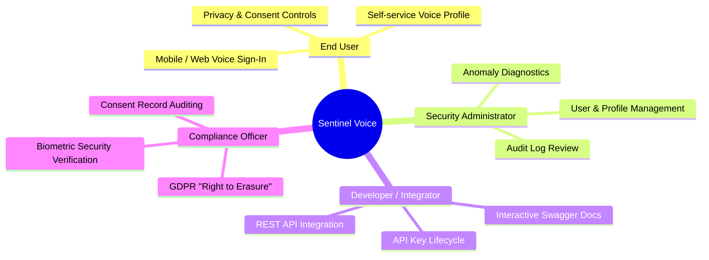

# Sentinel Voice — Product Vision & Strategic Scope
**Document ID:** `DOC-P7-01`  
**Phase:** 7A (Standalone Application Architecture & System Design)  
**Status:** Approved Architecture Draft  
**Target Platform:** Sentinel Voice Standalone SaaS  

---

## 1. Executive Summary & Product Identity

**Sentinel Voice** is a modern, standalone, enterprise-grade AI Speaker Verification Platform. Powered by pretrained deep Time Delay Neural Networks (ECAPA-TDNN), Sentinel Voice provides frictionless, deterministic, 1:1 voice biometric identity authentication.

Unlike generic voice processing pipelines, Sentinel Voice is engineered specifically as an **independent enterprise service** delivering high-accuracy voiceprint enrollment, real-time identity verification, biometric lifecycle management, and privacy-first architectural controls designed to support compliance with data protection frameworks such as GDPR and CCPA (subject to formal enterprise legal review).

> [!IMPORTANT]
> **Complete Repository & Domain Independence:**  
> Sentinel Voice is strictly decoupled from any external or sibling cybersecurity frameworks (specifically `jamiul848/sentinelai`). It operates as an entirely self-contained software ecosystem comprising a dedicated Next.js web application, a high-performance Python FastAPI service, an asynchronous ECAPA-TDNN inference pipeline, and an encrypted PostgreSQL database.

---

## 2. Core Value Proposition

In an era of rising credential theft, SIM swapping, and automated fraud, knowledge-based authentication (passwords, PINs, security questions) is fundamentally compromised. Sentinel Voice delivers **biometric identity assurance based on physiological and behavioral vocal characteristics**:

1. **Deterministic 1:1 Identity Verification:** Answers the precise question: *"Is the speaker in this live audio stream genuinely who they claim to be?"*
2. **Sub-Second Operational Latency:** Optimized CPU/GPU serial inference delivers verification decisions in $< 150\text{ ms}$ post-upload.
3. **High Discriminative Reliability:** Backed by rigorous benchmark validation ($99.09\%$ test accuracy, $0.28\%$ FAR, $1.02\%$ FRR at calibrated $\theta^* = 0.4059$).
4. **Zero-Trust Privacy & Biometric Security:** Biometric embeddings (192D vectors) are isolated, encrypted at rest using keys strictly decoupled from the database, and never returned in public APIs. Raw audio files are processed strictly in volatile memory without persistent disk storage.
5. **Configurable Threshold Management:** Verification thresholds are dynamically managed with complete model and calibration provenance, rather than being hardcoded across application logic.

---

## 3. Current Scope & Architectural Boundaries

### 3.1 Included in Phase 7 Scope (Speaker Verification Only)
The initial production release of Sentinel Voice focuses exclusively on speaker identity verification:

- **Enterprise User Management:** Multi-tenant organization support, administrative role-based access control (SuperAdmin, Admin, Analyst, EndUser).
- **Consent-Gated Voice Enrollment:** Explicit biometric consent tracking, quality-checked audio ingestion, multi-utterance centroid template aggregation ($K=3$).
- **1:1 Speaker Verification:** Real-time cosine similarity comparison against calibrated thresholds with immediate `MATCH` / `NO_MATCH` verdicts.
- **Voice Profile Lifecycle Management:** Profile status tracking (`ACTIVE`, `SUSPENDED`, `REVOKED`), re-enrollment, and cryptographic vector deletion.
- **Verification History & Auditing:** Comprehensive, privacy-preserving event logging (storing zero raw biometrics or audio).
- **Dual-Layer Analytics:** Strict operational separation between live runtime metrics and historical laboratory benchmarks.
- **Developer API & SDK Access:** Secure API key management, scoped access tokens, rate limiting, and interactive OpenAPI documentation.

### 3.2 Explicitly Postponed Capabilities (Future Architectural Extensions)
To preserve architectural purity, rigorous testing, and rapid time-to-market, the following advanced defense capabilities are **intentionally postponed**:

| Postponed Capability | Future Phase | Architectural Preparedness |
| :--- | :---: | :--- |
| **Presentation Attack Detection (PAD)** | Phase 8 | Preprocessor hooks accept raw waveforms for future parallel feature analysis (e.g. AASIST/RawNet2) without altering the ECAPA extraction pipeline. |
| **Malicious Conversation Intent Detection** | Phase 9 | API payload design includes optional conversation metadata fields to accept transcriptions/text downstream. |
| **Three-Level Security Fusion Engine** | Phase 10 | The verification decision schema contains modular scoring slots (`biometric_score`, `pad_score`, `intent_score`) defaulting currently to biometric-only mode. |

> [!WARNING]
> Under no circumstances will marketing materials, system UI, or API responses advertise or claim spoofing protection, deepfake defense, or threat intelligence until Phases 8–10 are formally developed, tested, and validated.

---

## 4. Target User Personas & Use Cases

### 4.1 Enterprise Security Administrator
- **Job to be Done:** Monitor organizational authentication health, revoke compromised voice profiles, inspect anomalous verification spikes, and enforce compliance policies.
- **Primary Interface:** Web Admin Dashboard, User Management Console, Verification History Explorer.

### 4.2 Software Developer / Enterprise Integrator
- **Job to be Done:** Embed voice verification into existing mobile apps, call center IVRs, or banking portals via REST APIs.
- **Primary Interface:** Developer Portal, API Key Manager, OpenAPI Documentation, Webhook Settings.

### 4.3 End User / Voice Claimant
- **Job to be Done:** Enroll vocal identity with minimal friction (3 short sentences) and perform frictionless verification from microphone or mobile device.
- **Primary Interface:** Responsive Voice Enrollment Wizard, Verification Widget, Privacy Consent Dashboard.

---

## 5. Architectural Quality Attributes & Non-Functional Requirements

1. **Accuracy & Consistency:** The production platform must uphold the performance standards proven in Phase 5 benchmark evaluations (operating within the 5% error tolerance window $\theta \in [0.2700, 0.5350]$).
2. **Stateless Scalability:** Web and API layers must remain completely stateless, delegating persistent state to PostgreSQL and biometric vector caching to secure storage.
3. **Ephemerality of Raw Audio:** Raw audio waveforms must be stored exclusively in volatile memory or temporary scratch directories with automatic lifetime expiration ($\le 60\text{ seconds}$).
4. **Data Minimization:** No biometric vector, audio recording, or user credential shall ever appear in application logs, audit logs, or public API error payloads.
5. **Independent Deployability:** The system can be containerized using Docker and Docker Compose with zero external cloud vendor lock-in.

