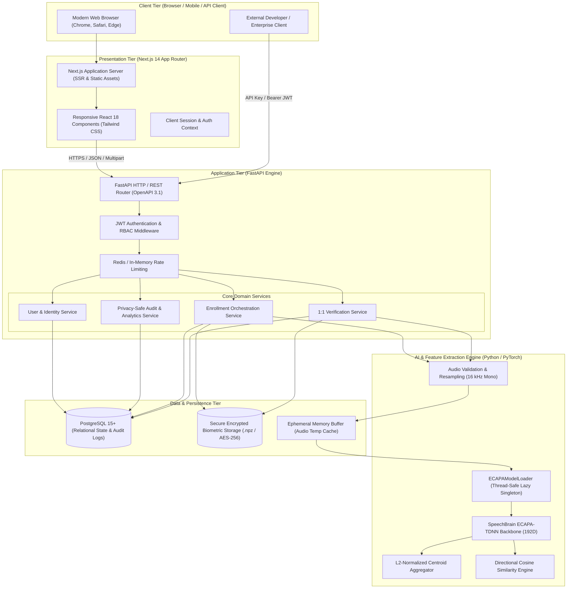
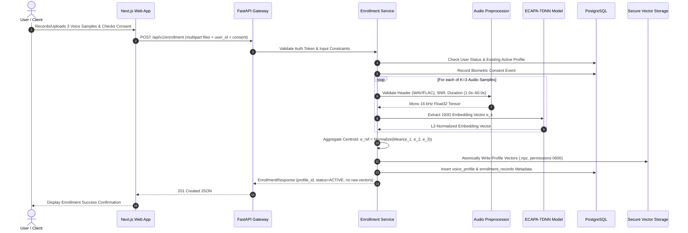
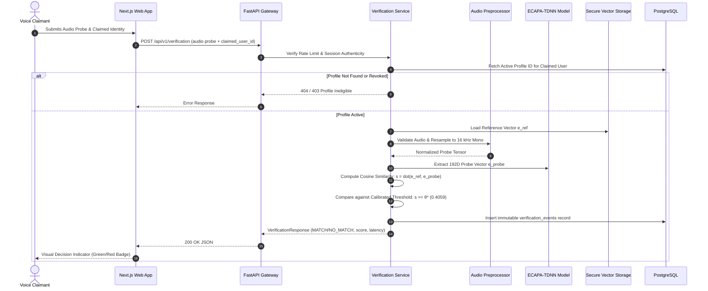

# Sentinel Voice — System Architecture & Topology
**Document ID:** `DOC-P7-02`  
**Phase:** 7A (Standalone Application Architecture & System Design)  
**Status:** Approved Architecture Draft  

---

## 1. High-Level Architecture Diagram

Sentinel Voice is structured as a modular, three-tier enterprise SaaS application. The frontend and backend communicate exclusively over strict, authenticated RESTful APIs over HTTPS/JSON.



---

## 2. Core Architectural Principles

### 2.1 Complete AI Inference Independence
The AI Inference Engine (`sentinelai.speaker`, `sentinelai.audio`) remains completely isolated from the web presentation layer:
- The Next.js frontend has **zero direct dependency** on PyTorch, SpeechBrain, or audio DSP code.
- Frontend components communicate exclusively via HTTP multipart form payloads and structured JSON responses.
- The AI layer accepts generic standard streams or byte buffers (`bytes` / `io.BytesIO`) and produces plain Python/NumPy arrays without web framework couplings.

### 2.2 Singleton Model Lifecycle Management
To maximize performance and prevent out-of-memory (OOM) crashes on resource-constrained systems (e.g. 8GB RAM host environments):
- Pretrained weights for `speechbrain/spkrec-ecapa-voxceleb` are loaded **strictly once** via `ECAPAModelLoader`.
- The model loader employs a thread-safe double-checked locking pattern (`threading.Lock()`).
- Workers and threads share the single in-memory instance for evaluation and inference.
- GPU acceleration (`cuda:0`) is automatically utilized if available; otherwise, it defaults gracefully to multi-threaded CPU inference.

### 2.3 Strict Separation of Biometric and Ordinary User Data
To align with biometric privacy principles (such as GDPR Article 9, CCPA, and Illinois BIPA):
- Relational user profile data (email, name, role, hashed passwords) is stored in standard PostgreSQL tables.
- Biometric embeddings (192-dimensional floating-point vectors) are **never stored in plain relational columns**.
- Embeddings are persisted in dedicated, encrypted binary storage (AES-256-GCM encrypted NumPy `.npz` containers with atomic filesystem writes and restricted file permissions `0600`).
- **Cryptographic Key Separation:** The master vector encryption key (`SENTINEL_BIOMETRIC_ENCRYPTION_KEY`) is stored strictly in isolated environment variables or an external KMS, completely decoupled from the PostgreSQL database.
- The database stores only foreign references, vector hashes (SHA-256), dimension metadata, and non-sensitive timestamps.

### 2.4 Ephemerality of Raw Voice Audio & In-Memory Ingestion
Raw audio recordings submitted for enrollment or verification are subject to strict data minimization:
1. Audio is held in volatile memory buffers (`io.BytesIO`) during container validation, decoding, and preprocessing.
2. Temporary disk files are avoided entirely. In the rare event a temporary disk scratch is required by a legacy library, it is written to a secure volatile RAM disk (`tmpfs`) and cryptographically zeroed immediately after tensor extraction.
3. Once the 192-dimensional embedding vector is extracted, the temporary audio memory buffer is overwritten and garbage collected.
4. Raw waveforms are **never permanently stored**, and neither audio bytes nor biometric vectors are ever logged in application traces.

### 2.5 Configurable Decision Threshold Management
The decision threshold is **never hardcoded** in application logic:
- While $\theta^* = 0.4059$ represents the historical Phase 5E scientific baseline (calibrated on LibriSpeech `dev-clean`), production systems require operational adaptability.
- The platform implements dynamic threshold management loaded from the `threshold_configurations` database entity or environment configuration.
- Each threshold record encapsulates:
  - Model identifier (e.g. `speechbrain/spkrec-ecapa-voxceleb`).
  - Active threshold value ($\theta$).
  - Calibration dataset and criterion (e.g. `equal_error_rate`).
  - Calibration metadata and historical provenance.
  - Active status toggle with administrative auditing.
- Historical Phase 5E research benchmark metrics remain immutable and preserved for research provenance.

### 2.6 Offloaded Asynchronous Concurrency
PyTorch tensor math and model forward passes are computationally intensive. To keep the ASGI async event loop responsive and maintain sub-second response times:
- All audio decoding and ECAPA embedding forward passes are offloaded from the event loop using `asyncio.to_thread` / AnyIO worker pools.
- The system is fully tested and optimized for CPU-only environments (bounded serial processing, memory footprint $< 1.5\text{ GB}$).

---

## 3. End-to-End Runtime Data Flows

### 3.1 Voice Enrollment Workflow


### 3.2 1:1 Voice Verification Workflow


---

## 4. Extension Hooks for Future Phases (Phases 8–10)

Although anti-spoofing, intent analysis, and security fusion are strictly postponed, the architecture defines concrete interface slots to ensure seamless future adoption without refactoring core services:

```python
# Sentinel Voice Modular Verification Pipeline (Architecture Interface)
class VerificationPipelineInterface:
    async def process_verification(self, audio_tensor, reference_profile):
        # Current Phase 7: Biometric Verification
        biometric_score = compute_cosine_similarity(
            extract_ecapa(audio_tensor), reference_profile.embedding
        )
        
        # Future Extension Slot (Phase 8): Presentation Attack Detection
        # pad_score = await pad_engine.predict_bona_fide(audio_tensor)
        pad_score = None 
        
        # Future Extension Slot (Phase 9): Malicious Intent Detection
        # intent_score = await intent_engine.analyze(audio_tensor)
        intent_score = None
        
        # Future Extension Slot (Phase 10): Three-Level Fusion Decision
        # decision = fusion_engine.fuse(biometric_score, pad_score, intent_score)
        decision = "MATCH" if biometric_score >= CALIBRATED_THRESHOLD else "NO_MATCH"
        
        return VerificationResult(
            decision=decision,
            similarity_score=biometric_score,
            pad_score=pad_score,
            intent_score=intent_score
        )
```

