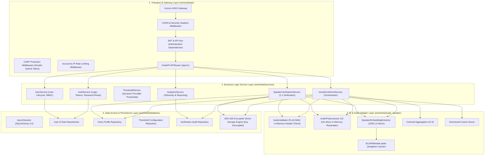

# Sentinel Voice — Backend Architecture & Service Layer
**Document ID:** `DOC-P7-04`  
**Phase:** 7A (Standalone Application Architecture & System Design)  
**Status:** Approved Architecture Draft  

---

## 1. Architectural Principles & Technology Foundation

The Sentinel Voice backend is architected as an asynchronous, high-throughput micro-service gateway designed around Python 3.10+, FastAPI, and SQLAlchemy 2.0.

| Component | Technology | Rationale |
| :--- | :--- | :--- |
| **API Framework** | **FastAPI 0.100+** | Native ASGI async performance, automatic OpenAPI 3.1 generation, and strict Pydantic v2 data validation. |
| **Data Validation** | **Pydantic v2** | High-performance C-compiled schema validation, strict typing, and serialization. |
| **ORM & Database Layer** | **SQLAlchemy 2.0 (Async)** | Async database queries using `asyncpg` driver, declarative models, and clean separation of concerns. |
| **Migration Engine** | **Alembic** | Deterministic, version-controlled database schema migrations. |
| **Authentication & Tokens** | **PyJWT + Passlib (Argon2id)** | Industry-standard password hashing and cryptographically signed JSON Web Tokens. |
| **AI Inference Runtime** | **PyTorch + SpeechBrain** | Reuses verified ECAPA-TDNN feature extraction pipeline. |
| **Task Concurrency** | **AnyIO / `asyncio.to_thread`** | Isolates CPU-bound PyTorch neural network forward passes from the async event loop. |

---

## 2. Layered Architecture & Component Interaction



---

## 3. Preserving & Integrating Existing Modules

Sentinel Voice directly reuses the mature, benchmark-tested scientific modules developed in Phases 1 through 5, without altering their internal mathematical logic:

1. **`sentinelai.audio` (Audio Preprocessing):**
   - Direct reuse of `validate_audio_header()` (supporting both `b'fLaC'` and `b'RIFF/WAVE'`).
   - Direct reuse of `AudioPreprocessor` enforcing 16 kHz mono downmixing and RMS normalization.
   - Enforces configurable duration bounds ($1.0\text{s} \le \text{duration} \le 60.0\text{s}$).
2. **`sentinelai.speaker` (ECAPA-TDNN Integration):**
   - Direct reuse of `ECAPAModelLoader` ensuring single-load model caching in memory.
   - Direct reuse of `SpeakerEmbeddingExtractor` extracting 192-dimensional unit-length vectors.
   - Direct reuse of directional cosine similarity with floating-point numerical clamping $[-1.0, 1.0]$.
3. **`sentinelai.enrollment` (Voice Profile Management):**
   - Reuses `aggregate_embeddings()` multi-sample averaging algorithm.
   - Extends `ProfileStorageBackend` with a new `PostgreSQLProfileStorage` driver alongside `LocalFileProfileStorage`.
4. **`sentinelai.verification` (1:1 Verification Engine):**
   - Reuses `VerificationThreshold` and the empirically calibrated threshold ($\theta^* = 0.4059$).
   - Extends `AuditLoggerBackend` to record verification attempts into PostgreSQL.

---

## 4. Offloading CPU/GPU-Bound Model Inference

FastAPI operates on an asynchronous event loop (`asyncio`). Executing heavy PyTorch tensor math and model forward passes directly inside an `async def` route would block the event loop, causing request starvation for all concurrent users.

To maintain sub-second responsiveness under concurrent loads:
```python
# Concurrency Architecture: Offload CPU-bound inference to worker threadpool
from anyio import to_thread

async def extract_speaker_embedding(audio_tensor: torch.Tensor) -> np.ndarray:
    """Executes ECAPA-TDNN inference in a background threadpool."""
    extractor = get_embedding_extractor()
    # Runs the synchronous PyTorch model forward pass without blocking ASGI loop
    embedding_result = await to_thread.run_sync(
        extractor.extract_from_tensor, audio_tensor
    )
    return embedding_result.embedding
```

---

## 5. Error Handling & Standardized Responses

All errors across the platform adhere to the **RFC 7807 (Problem Details for HTTP APIs)** standard:

```json
{
  "type": "https://sentinelvoice.ai/errors/profile-not-found",
  "title": "Voice Profile Not Found",
  "status": 404,
  "detail": "No active voice profile was found for user ID 'usr_01HX983AB7'. The profile may be revoked or un-enrolled.",
  "instance": "/api/v1/verification",
  "timestamp": "2026-11-12T17:15:00Z"
}
```

### Standard Exception Hierarchy
- `SentinelVoiceError` (Base Domain Exception)
  - `AuthenticationError` (Invalid credentials, expired token)
  - `AuthorizationError` (Insufficient role permissions)
  - `AudioValidationError` (Unsupported container, invalid sample rate, duration error)
  - `BiometricEnrollmentError` (Insufficient samples, duplicate enrollment, missing consent)
  - `VerificationError` (Profile revoked, vector dimension mismatch)
  - `StorageError` (Database or vector persistence failure)

