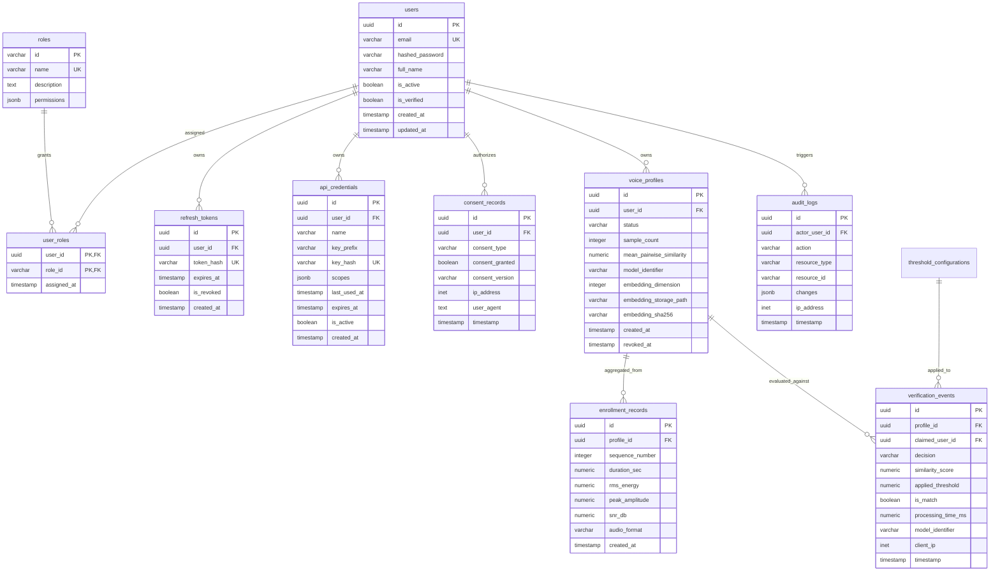

# Sentinel Voice — Relational Database Architecture & Schema Specification
**Document ID:** `DOC-P7-05`  
**Phase:** 7A (Standalone Application Architecture & System Design)  
**Status:** Approved Architecture Draft  

---

## 1. Database Architecture & ER Diagram

Sentinel Voice utilizes **PostgreSQL 15+** as its primary persistent relational store. The schema is organized to strictly isolate ordinary user account data from biometric metadata and audit logs.

---

## 2. Table-by-Table Schema Specification

### 2.1 `users` Table
Stores primary user identity, authentication credentials, and account operational status.

| Column | Data Type | Constraints | Description |
| :--- | :--- | :--- | :--- |
| `id` | `UUID` | `PRIMARY KEY, DEFAULT gen_random_uuid()` | Immutable unique identifier. |
| `email` | `VARCHAR(255)` | `NOT NULL, UNIQUE` | User login email (case-insensitive indexed). |
| `hashed_password` | `VARCHAR(255)` | `NOT NULL` | Argon2id cryptographically salted password hash. |
| `full_name` | `VARCHAR(150)` | `NOT NULL` | Display name of the user. |
| `is_active` | `BOOLEAN` | `NOT NULL, DEFAULT TRUE` | Active account toggle (administrative deactivation). |
| `is_verified` | `BOOLEAN` | `NOT NULL, DEFAULT FALSE` | Email verification flag. |
| `created_at` | `TIMESTAMPTZ` | `NOT NULL, DEFAULT CURRENT_TIMESTAMP` | Account creation timestamp. |
| `updated_at` | `TIMESTAMPTZ` | `NOT NULL, DEFAULT CURRENT_TIMESTAMP` | Last profile update timestamp. |

- **Indexes:**
  - `idx_users_email` (B-tree on `LOWER(email)`).
  - `idx_users_active` (B-tree on `is_active`).

---

### 2.2 `roles` Table
Defines available system access roles.

| Column | Data Type | Constraints | Description |
| :--- | :--- | :--- | :--- |
| `id` | `VARCHAR(50)` | `PRIMARY KEY` | Semantic identifier (e.g. `'SUPER_ADMIN'`, `'ADMIN'`, `'ANALYST'`, `'END_USER'`). |
| `name` | `VARCHAR(100)` | `NOT NULL, UNIQUE` | Human-readable role title. |
| `description` | `TEXT` | `NULL` | Detailed explanation of permissions. |
| `permissions` | `JSONB` | `NOT NULL, DEFAULT '[]'` | Scoped permission strings (e.g. `["verification:read", "enrollment:create"]`). |

---

### 2.3 `user_roles` Table
Many-to-many junction table mapping users to roles.

| Column | Data Type | Constraints | Description |
| :--- | :--- | :--- | :--- |
| `user_id` | `UUID` | `NOT NULL, REFERENCES users(id) ON DELETE CASCADE` | Target user ID. |
| `role_id` | `VARCHAR(50)` | `NOT NULL, REFERENCES roles(id) ON DELETE CASCADE` | Assigned role ID. |
| `assigned_at` | `TIMESTAMPTZ` | `NOT NULL, DEFAULT CURRENT_TIMESTAMP` | Assignment timestamp. |

- **Primary Key:** `(user_id, role_id)`.

---

### 2.4 `refresh_tokens` Table
Manages active refresh token sessions supporting strict rotation and revocation.

| Column | Data Type | Constraints | Description |
| :--- | :--- | :--- | :--- |
| `id` | `UUID` | `PRIMARY KEY, DEFAULT gen_random_uuid()` | Unique session identifier. |
| `user_id` | `UUID` | `NOT NULL, REFERENCES users(id) ON DELETE CASCADE` | Token owner. |
| `token_hash` | `VARCHAR(64)` | `NOT NULL, UNIQUE` | SHA-256 hash of the issued refresh token. |
| `expires_at` | `TIMESTAMPTZ` | `NOT NULL` | Expiration boundary (typically 7–30 days). |
| `is_revoked` | `BOOLEAN` | `NOT NULL, DEFAULT FALSE` | Instant revocation flag. |
| `created_at` | `TIMESTAMPTZ` | `NOT NULL, DEFAULT CURRENT_TIMESTAMP` | Issuance timestamp. |

- **Indexes:**
  - `idx_refresh_tokens_hash` (B-tree on `token_hash`).
  - `idx_refresh_tokens_user` (B-tree on `user_id, is_revoked`).

---

### 2.5 `api_credentials` Table
Enables developer API programmatic access.

| Column | Data Type | Constraints | Description |
| :--- | :--- | :--- | :--- |
| `id` | `UUID` | `PRIMARY KEY, DEFAULT gen_random_uuid()` | Unique credential identifier. |
| `user_id` | `UUID` | `NOT NULL, REFERENCES users(id) ON DELETE CASCADE` | Credential owner. |
| `name` | `VARCHAR(100)` | `NOT NULL` | Label given by developer (e.g. `'Production IVR'`). |
| `key_prefix` | `VARCHAR(16)` | `NOT NULL` | Visible prefix (e.g. `'sv_live_7aB8'`). |
| `key_hash` | `VARCHAR(64)` | `NOT NULL, UNIQUE` | SHA-256 hash of the secret API key. |
| `scopes` | `JSONB` | `NOT NULL, DEFAULT '["verify"]'` | List of allowed API scopes. |
| `last_used_at` | `TIMESTAMPTZ` | `NULL` | Telemetry of last API call. |
| `expires_at` | `TIMESTAMPTZ` | `NULL` | Optional expiration date. |
| `is_active` | `BOOLEAN` | `NOT NULL, DEFAULT TRUE` | Active status toggle. |
| `created_at` | `TIMESTAMPTZ` | `NOT NULL, DEFAULT CURRENT_TIMESTAMP` | Issuance timestamp. |

- **Indexes:**
  - `idx_api_keys_hash` (B-tree on `key_hash`).

---

### 2.6 `consent_records` Table
Maintains an immutable legal audit trail of biometric consent (GDPR / BIPA compliance).

| Column | Data Type | Constraints | Description |
| :--- | :--- | :--- | :--- |
| `id` | `UUID` | `PRIMARY KEY, DEFAULT gen_random_uuid()` | Unique consent transaction ID. |
| `user_id` | `UUID` | `NOT NULL, REFERENCES users(id) ON DELETE CASCADE` | Consenting user. |
| `consent_type` | `VARCHAR(50)` | `NOT NULL, DEFAULT 'VOICE_BIOMETRIC_ENROLLMENT'` | Policy identifier. |
| `consent_granted` | `BOOLEAN` | `NOT NULL, CHECK (consent_granted = TRUE)` | Explicit grant flag (must be TRUE). |
| `consent_version` | `VARCHAR(20)` | `NOT NULL` | Policy legal version string (e.g. `'v1.2'`). |
| `ip_address` | `INET` | `NULL` | Ingesting IP address for compliance proof. |
| `user_agent` | `TEXT` | `NULL` | Browser / device client string. |
| `timestamp` | `TIMESTAMPTZ` | `NOT NULL, DEFAULT CURRENT_TIMESTAMP` | Verification timestamp. |

---

### 2.7 `voice_profiles` Table
Tracks speaker voice profile lifecycle and references to isolated biometric vector storage.

| Column | Data Type | Constraints | Description |
| :--- | :--- | :--- | :--- |
| `id` | `UUID` | `PRIMARY KEY, DEFAULT gen_random_uuid()` | Unique profile identifier. |
| `user_id` | `UUID` | `NOT NULL, REFERENCES users(id) ON DELETE CASCADE` | Enrolled user ID. |
| `status` | `VARCHAR(20)` | `NOT NULL, DEFAULT 'ACTIVE'` | `'ACTIVE'`, `'SUSPENDED'`, or `'REVOKED'`. |
| `sample_count` | `INTEGER` | `NOT NULL, CHECK (sample_count >= 3)` | Enrollment utterance count ($K=3$). |
| `mean_pairwise_similarity` | `NUMERIC(6,4)` | `NOT NULL` | Consistency score between enrollment samples. |
| `model_identifier` | `VARCHAR(100)` | `NOT NULL` | Model string (e.g. `'speechbrain/spkrec-ecapa-voxceleb'`). |
| `embedding_dimension` | `INTEGER` | `NOT NULL, DEFAULT 192` | Latent space dimensionality. |
| `embedding_storage_path` | `VARCHAR(512)` | `NOT NULL` | File URI / storage path for isolated `.npz` vector. |
| `embedding_sha256` | `VARCHAR(64)` | `NOT NULL` | Cryptographic SHA-256 hash of the vector bytes. |
| `created_at` | `TIMESTAMPTZ` | `NOT NULL, DEFAULT CURRENT_TIMESTAMP` | Profile creation timestamp. |
| `revoked_at` | `TIMESTAMPTZ` | `NULL` | Revocation timestamp if deactivated. |

- **Indexes:**
  - `idx_voice_profiles_user_active` (Partial B-tree on `user_id WHERE status = 'ACTIVE'`).
  - `idx_voice_profiles_status` (B-tree on `status`).

---

### 2.8 `enrollment_records` Table
Stores acoustic metadata for each individual audio sample used to compose the reference centroid.

| Column | Data Type | Constraints | Description |
| :--- | :--- | :--- | :--- |
| `id` | `UUID` | `PRIMARY KEY, DEFAULT gen_random_uuid()` | Unique recording entry ID. |
| `profile_id` | `UUID` | `NOT NULL, REFERENCES voice_profiles(id) ON DELETE CASCADE` | Associated voice profile. |
| `sequence_number` | `INTEGER` | `NOT NULL, CHECK (sequence_number BETWEEN 1 AND 10)` | Ordinal sample index ($1, 2, 3$). |
| `duration_sec` | `NUMERIC(6,3)` | `NOT NULL, CHECK (duration_sec BETWEEN 1.0 AND 60.0)` | Audio duration in seconds. |
| `rms_energy` | `NUMERIC(8,6)` | `NOT NULL` | Acoustic RMS energy measurement. |
| `peak_amplitude` | `NUMERIC(8,6)` | `NOT NULL` | Normalized peak amplitude. |
| `snr_db` | `NUMERIC(6,2)` | `NULL` | Estimated Signal-to-Noise Ratio (dB). |
| `audio_format` | `VARCHAR(10)` | `NOT NULL` | Decoded source format (`'WAV'` or `'FLAC'`). |
| `created_at` | `TIMESTAMPTZ` | `NOT NULL, DEFAULT CURRENT_TIMESTAMP` | Ingestion timestamp. |

> [!CAUTION]
> **Zero Audio Invariant:** Notice that `enrollment_records` stores **only numerical acoustic metadata**. Under no circumstances does this table contain binary audio blobs, audio paths, or waveforms.

---

### 2.9 `verification_events` Table
Maintains an immutable, append-only log of every 1:1 speaker verification attempt.

| Column | Data Type | Constraints | Description |
| :--- | :--- | :--- | :--- |
| `id` | `UUID` | `PRIMARY KEY, DEFAULT gen_random_uuid()` | Unique verification transaction ID. |
| `profile_id` | `UUID` | `NULL, REFERENCES voice_profiles(id) ON DELETE SET NULL` | Reference profile evaluated. |
| `claimed_user_id` | `UUID` | `NOT NULL, REFERENCES users(id) ON DELETE CASCADE` | Identity claimed by the probe. |
| `decision` | `VARCHAR(20)` | `NOT NULL` | `'MATCH'` or `'NO_MATCH'`. |
| `similarity_score` | `NUMERIC(7,6)` | `NOT NULL` | Cosine similarity $s \in [-1.0, 1.0]$. |
| `applied_threshold` | `NUMERIC(7,6)` | `NOT NULL` | Operating threshold used (e.g. `0.405898`). |
| `is_match` | `BOOLEAN` | `NOT NULL` | Boolean verdict ($s \ge \theta^*$). |
| `processing_time_ms` | `NUMERIC(8,2)` | `NOT NULL` | Total processing wall-clock time in ms. |
| `model_identifier` | `VARCHAR(100)` | `NOT NULL` | Model used for probe extraction. |
| `client_ip` | `INET` | `NULL` | Originating client network address. |
| `timestamp` | `TIMESTAMPTZ` | `NOT NULL, DEFAULT CURRENT_TIMESTAMP` | Verification event timestamp. |

- **Indexes:**
  - `idx_verif_events_user_time` (B-tree on `claimed_user_id, timestamp DESC`).
  - `idx_verif_events_decision` (B-tree on `decision, timestamp DESC`).
  - `idx_verif_events_time` (B-tree on `timestamp DESC`).

---

### 2.10 `audit_logs` Table
Administrative and security transaction ledger.

| Column | Data Type | Constraints | Description |
| :--- | :--- | :--- | :--- |
| `id` | `UUID` | `PRIMARY KEY, DEFAULT gen_random_uuid()` | Audit log identifier. |
| `actor_user_id` | `UUID` | `NULL, REFERENCES users(id) ON DELETE SET NULL` | Performing user (or NULL for system). |
| `action` | `VARCHAR(50)` | `NOT NULL` | Action type (e.g. `'PROFILE_REVOKE'`, `'ROLE_CHANGE'`). |
| `resource_type` | `VARCHAR(50)` | `NOT NULL` | Affected resource (e.g. `'voice_profile'`, `'user'`). |
| `resource_id` | `VARCHAR(64)` | `NOT NULL` | Identifier of the affected entity. |
| `changes` | `JSONB` | `NULL` | Prior and post states (omitting passwords/vectors). |
| `ip_address` | `INET` | `NULL` | Administrative IP address. |
| `timestamp` | `TIMESTAMPTZ` | `NOT NULL, DEFAULT CURRENT_TIMESTAMP` | Event timestamp. |

- **Indexes:**
  - `idx_audit_logs_actor` (B-tree on `actor_user_id, timestamp DESC`).
  - `idx_audit_logs_resource` (B-tree on `resource_type, resource_id`).

---

### 2.11 `threshold_configurations` Table
Manages active and historical decision thresholds dynamically, avoiding hardcoded values in application logic.

| Column | Data Type | Constraints | Description |
| :--- | :--- | :--- | :--- |
| `id` | `UUID` | `PRIMARY KEY, DEFAULT gen_random_uuid()` | Unique configuration identifier. |
| `version_tag` | `VARCHAR(50)` | `NOT NULL, UNIQUE` | Version identifier (e.g. `'ecapa-voxceleb-v1.0'`). |
| `model_identifier` | `VARCHAR(100)` | `NOT NULL` | Neural model (e.g. `'speechbrain/spkrec-ecapa-voxceleb'`). |
| `threshold_value` | `NUMERIC(7,6)` | `NOT NULL` | Active decision threshold $\theta$ (e.g. `0.405898`). |
| `calibration_dataset` | `VARCHAR(100)` | `NOT NULL` | Corpus used (e.g. `'LibriSpeech dev-clean'`). |
| `calibration_criterion` | `VARCHAR(50)` | `NOT NULL, DEFAULT 'equal_error_rate_minimization'` | Method used to derive threshold. |
| `calibration_metadata` | `JSONB` | `NOT NULL, DEFAULT '{}'` | Empirical metrics (EER, FAR, FRR, score ranges). |
| `is_active` | `BOOLEAN` | `NOT NULL, DEFAULT FALSE` | Flag indicating current system-wide active threshold. |
| `created_at` | `TIMESTAMPTZ` | `NOT NULL, DEFAULT CURRENT_TIMESTAMP` | Creation timestamp. |
| `updated_at` | `TIMESTAMPTZ` | `NOT NULL, DEFAULT CURRENT_TIMESTAMP` | Last update timestamp. |

- **Indexes:**
  - `idx_threshold_config_active` (Partial B-tree on `is_active WHERE is_active = TRUE`).
  - `idx_threshold_config_version` (B-tree on `version_tag`).

---

## 3. Biometric Vector Encryption & Key Management Rules

1. **At-Rest Encryption:** Embedding vector payloads (`.npz` files) are encrypted using AES-256-GCM before writing to the designated storage path.
2. **Key Decoupling Invariant:** The master symmetric encryption key (`SENTINEL_BIOMETRIC_ENCRYPTION_KEY`) is provided exclusively via environment variable or external KMS. Under no circumstances is the key stored in the PostgreSQL database.
3. **Public API Vector Masking:** All database queries for voice profiles select only scalar metadata; raw vector payloads are never mapped to public Pydantic models.
4. **Guaranteed Erasure:** Upon profile deletion (`DELETE /api/v1/enrollment/{profile_id}`), the encrypted vector container on disk is overwritten with random bytes and unlinked.

