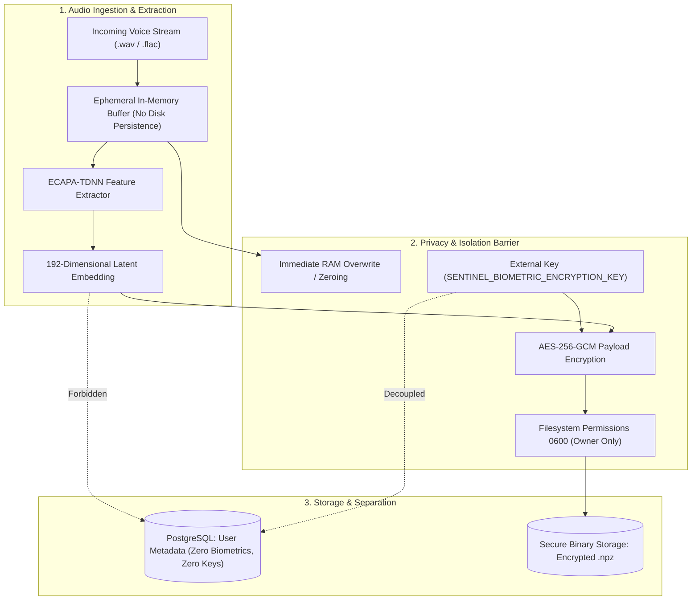
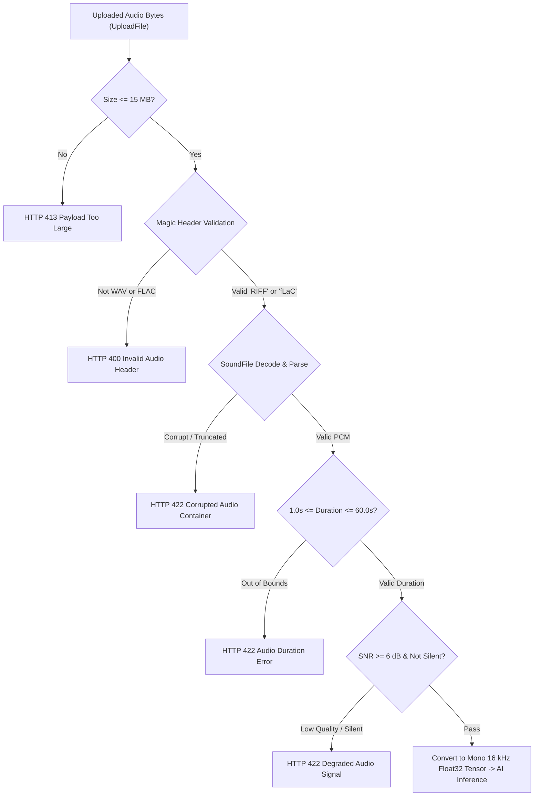

# Sentinel Voice — Security, Biometric Privacy & Compliance Architecture
**Document ID:** `DOC-P7-07`  
**Phase:** 7A (Standalone Application Architecture & System Design)  
**Status:** Approved Architecture Draft  

---

## 1. Biometric Security & Privacy Framework

Biometric characteristics (such as human vocal tracts and speech patterns) are irrevocable: unlike passwords, a compromised voiceprint cannot be reissued. Sentinel Voice enforces a strict **Zero-Trust Biometric Privacy Framework** designed to support alignment with international standards and privacy regulations (including ISO/IEC 24745, GDPR Article 9, CCPA, and Illinois BIPA), subject to independent enterprise legal assessment.

---

## 2. Invariants: What Sentinel Voice Never Stores, Exposes, or Logs

To eliminate attack vectors and prevent regulatory liability, the platform strictly enforces these core negative constraints:

| Prohibited Entity | Enforcement Mechanism |
| :--- | :--- |
| **Raw Voice Recordings** | Never written to database tables or persistent storage. Audio bytes reside strictly in memory (`io.BytesIO`) for the duration of inference ($< 200\text{ ms}$) and are wiped upon completion. |
| **Temporary Disk Files** | Audio processing is executed entirely in RAM. If a temporary file is ever created by an underlying library, it is written to a volatile RAM disk (`tmpfs`) and cryptographically zeroed immediately. |
| **Raw Biometric Embeddings in Public APIs** | The 192D float array is stripped by Pydantic response models (`SpeakerProfilePublic`). No public endpoint returns vector weights. |
| **Audio or Biometrics in Logs** | Application loggers, audit loggers, and exception handlers are strictly prohibited from logging raw audio, tensors, embedding vectors, or hashes. |
| **Plaintext Password Credentials** | All passwords are salted and hashed with Argon2id prior to SQL insertion. |
| **Unrestricted API Keys** | API keys are hashed with SHA-256; only the prefix (`sv_live_...`) is retained in plaintext for indexing. |
| **Encryption Keys in Database** | The master biometric vector encryption key (`SENTINEL_BIOMETRIC_ENCRYPTION_KEY`) is kept strictly in environment variables or external KMS, decoupled from PostgreSQL. |

---

## 3. Cryptographic & Authentication Controls

### 3.1 Password Hashing Specification
User passwords are treated with **Argon2id** (the winner of the Password Hashing Competition):
- Memory cost ($m$): $65,536\text{ KiB}$ ($64\text{ MB}$).
- Time cost ($t$): $3$ iterations.
- Parallelism ($p$): $4$ lanes.
- Cryptographic salt: $16\text{ bytes}$ generated via CSPRNG (`secrets.token_bytes(16)`).

### 3.2 Access Token (JWT) Security
- **Algorithm:** `HS256` with high-entropy $\ge 256$-bit secret (or `RS256` with asymmetric key pairs in multi-node clusters).
- **Token Lifetime:** Exactly $15\text{ minutes}$ ($900\text{ seconds}$).
- **Required Claims:**
  - `sub`: User UUID.
  - `jti`: Unique Token ID for revocation.
  - `exp`: Expiration UNIX timestamp.
  - `iat`: Issuance timestamp.
  - `roles`: Array of assigned role strings.

### 3.3 Refresh Token Rotation (RTR)
- **Token Format:** Cryptographically random 64-character hex string.
- **Storage:** Stored in PostgreSQL as a SHA-256 hash.
- **Rotation Rule:** Every call to `/api/v1/auth/refresh` **burns the existing token** and issues a brand-new token pair.
- **Breach Detection:** If an already-burned refresh token is presented, the system treats it as token theft, invalidating the entire token family and forcing all active sessions for that user to log out immediately.

### 3.4 CSRF Protection for Cookie-Based Sessions
To protect cookie-based refresh tokens against Cross-Site Request Forgery (CSRF):
- **SameSite Flag:** Refresh cookies are marked `SameSite=Strict` and `Secure=True` (HTTPS only).
- **Double-Submit Token:** During authentication, a cryptographically random CSRF token is issued in a separate readable cookie (`csrf_token`).
- **Header Enforcement:** State-changing requests (`/api/v1/auth/refresh`, `/api/v1/auth/logout`) strictly require the `X-CSRF-Token` HTTP header matching the cookie value; missing or mismatched headers result in HTTP 403 Forbidden.

---

## 4. Role-Based Access Control (RBAC) Matrix

| Resource / Action | `SUPER_ADMIN` | `ADMIN` | `ANALYST` | `END_USER` |
| :--- | :---: | :---: | :---: | :---: |
| **System Health & Telemetry** | Full | Full | Read-Only | Denied |
| **User Directory (Browse / Filter)** | Full | Full | Read-Only | Denied |
| **User Creation & Role Modification** | Full | Denied | Denied | Denied |
| **Own Profile Inspection / Update** | Full | Full | Full | Self Only |
| **Voice Profile Enrollment** | Any User | Any User | Denied | Self Only |
| **Voice Profile Revocation** | Any User | Any User | Denied | Self Only |
| **1:1 Voice Verification Execution** | Allowed | Allowed | Allowed | Allowed |
| **Verification History Audit Logs** | Global | Global | Global (Sanitized) | Self Only |
| **API Key Generation & Rotation** | Allowed | Allowed | Allowed | Self Only |
| **Profile Deletion (Right to Erasure)** | Allowed | Allowed | Denied | Self Only |

---

## 5. Multi-Layer Rate Limiting (IP & Account-Level)

To prevent brute-force attacks, denial-of-service, and credential stuffing against biometric endpoints:

### 5.1 Endpoint Rate Limits
| Endpoint Route | Default Rate Limit | Burst Allowance | Action on Exceeded |
| :--- | :---: | :---: | :---: |
| `/api/v1/auth/login` | 5 requests / min | 10 requests | HTTP 429 + IP Lockout (15 mins) |
| `/api/v1/auth/register` | 3 requests / hour | 5 requests | HTTP 429 |
| `/api/v1/enrollment` | 10 requests / hour | 15 requests | HTTP 429 |
| `/api/v1/verification` | 60 requests / min | 120 requests | HTTP 429 |
| General API Routes | 300 requests / min | 500 requests | HTTP 429 |

### 5.2 Account-Level Rate Limiting & Lockout
In addition to IP-level throttling, Sentinel Voice enforces account-level protection:
- **Failed Login Lockout:** 5 consecutive failed login attempts on a specific email account triggers a temporary 15-minute lock on that account, irrespective of client IP address.
- **Verification Burst Cap:** Individual accounts are throttled if more than 30 verification attempts per minute are targeted at the same user profile, preventing automated enumeration attacks.

---

## 6. Audio Ingestion & File Validation Defense

Before passing any uploaded audio bytes to the neural network, the audio is subjected to strict defense-in-depth validation:

1. **Memory Ceiling:** Upload payload size is capped at $15\text{ MB}$.
2. **Container Header Validation:** Strictly checks container magic bytes (`b'RIFF....WAVE'` or `b'fLaC'`). Disallows arbitrary extensions or container masquerading.
3. **Finite Floating-Point Checks:** Confirms zero NaNs or Infinities in decoded PCM tensors.
4. **Signal Energy Checks:** Rejects silent audio (RMS energy below $-60\text{ dBFS}$) and severely clipped audio ($> 99.9\%$ samples at full-scale amplitude).

---

## 7. Biometric Governance: Consent, Revocation & Erasure Controls

Sentinel Voice implements software controls designed to support adherence to privacy principles (such as GDPR Article 17 "Right to Erasure" and BIPA § 15(a) retention schedules), subject to customer-specific legal compliance assessments:

- **Explicit Consent Ledger:** Prior to voice enrollment, users must explicitly grant consent via `/api/v1/enrollment` (`consent: true`), which creates an immutable record in `consent_records`.
- **Profile Revocation (`POST /api/v1/enrollment/{profile_id}/revoke`):** Marks profile status as `REVOKED`. The profile immediately ceases to match incoming claimants.
- **Cryptographic Vector Erasure (`DELETE /api/v1/enrollment/{profile_id}`):**
  1. The underlying `.npz` vector file is overwritten with pseudorandom bytes before being unlinked from disk (`os.remove()`).
  2. The foreign key reference in `voice_profiles` is cleared, and the profile record is permanently purged.
  3. Associated `enrollment_records` are permanently purged.
  4. Non-biometric audit event rows (`verification_events`) are retained for enterprise compliance with the profile reference set to `NULL`.

> [!NOTE]
> **Legal Disclaimer:** While Sentinel Voice provides the necessary technical controls (consent capture, vector isolation, revocation, and cryptographic deletion), formal regulatory compliance depends on deployment context, jurisdiction, and customer operational procedures, requiring independent legal evaluation.

