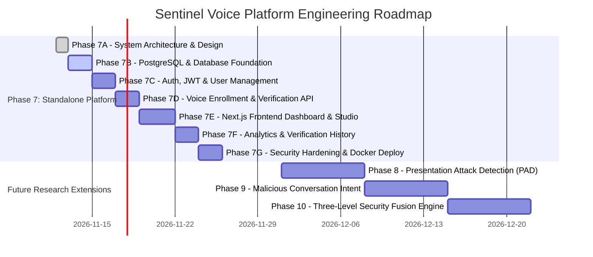

# Sentinel Voice — Master Implementation Roadmap & Milestone Strategy
**Document ID:** `DOC-P7-09`  
**Phase:** 7A (Standalone Application Architecture & System Design)  
**Status:** Approved Architecture Draft  

---

## 1. Master Milestone Overview

The evolution of Sentinel Voice from a research prototype into a commercial-grade, standalone AI Speaker Verification Platform is organized into 7 structured engineering phases, followed by 3 future advanced defense research phases:

---

## 2. Phase-by-Phase Execution Details

### Phase 7A: Standalone Application Architecture & System Design (CURRENT)
- **Objective:** Finalize product vision, technical stack, system diagrams, relational database schema, REST API contracts, security framework, repository structure, and roadmap.
- **Deliverables:** Complete documentation suite in `docs/phase-7/` (`01` through `09`).
- **Exit Criteria:** Architecture approved by product owner.

---

### Phase 7B: PostgreSQL Database, Alembic Migrations & Backend Foundation
- **Objective:** Establish the persistent database tier, dynamic threshold repository, vector encryption engine, and async ORM repositories.
- **Key Tasks:**
  1. Add backend database dependencies to `pyproject.toml` (`sqlalchemy>=2.0.0`, `asyncpg>=0.28.0`, `alembic>=1.12.0`, `pydantic-settings>=2.0.0`, `cryptography>=41.0.0`).
  2. Implement configuration manager (`sentinelai/config.py`) loading database credentials and `SENTINEL_BIOMETRIC_ENCRYPTION_KEY` from environment variables (`.env`).
  3. Implement async database connection engine and session factory (`sentinelai/database/connection.py`).
  4. Create Declarative Base and define all 11 SQLAlchemy ORM models:
     - `User`, `Role`, `UserRole`, `RefreshToken`
     - `VoiceProfile`, `EnrollmentRecord`, `ConsentRecord`
     - `VerificationEvent`, `ThresholdConfiguration`
     - `AuditLog`, `ApiCredential`
  5. Implement standalone biometric vector encryption helper (`sentinelai/auth/crypto.py`) with AES-256-GCM, ensuring keys are decoupled from database records.
  6. Initialize Alembic migration environment and generate baseline migration script `0001_initial_schema.py`.
  7. Create generic and model-specific Repository classes (`UserRepository`, `ProfileRepository`, `ThresholdRepository`, `AuditRepository`).
  8. Implement unit tests for database transactions, rollbacks, vector encryption round-trips, and foreign key constraints.
- **Exit Criteria:** `alembic upgrade head` executes cleanly on PostgreSQL, and all new and existing tests achieve 100% pass rate.

---

### Phase 7C: Authentication, Session Management & Role-Based Access Control
- **Objective:** Implement secure user registration, login, token rotation, and RBAC authorization guards.
- **Key Tasks:**
  1. Implement Argon2id password hashing and verification in `sentinelai/auth/security.py`.
  2. Implement JWT token encoder, decoder, and claims validator.
  3. Implement refresh token generation, hashing, and rotation logic in `sentinelai/services/auth_service.py`.
  4. Build dependency injection security guards (`get_current_user`, `require_role`, `verify_api_key`).
  5. Implement `/api/v1/auth` endpoints (`register`, `login`, `refresh`, `logout`).
  6. Implement `/api/v1/users` endpoints (`me`, `update`, `list`, `manage_roles`).
  7. Add automated tests covering brute-force lockout, token expiration, and role unauthorized rejections.
- **Exit Criteria:** Complete auth lifecycle verified via automated integration tests.

---

### Phase 7D: Voice Enrollment & Verification API Service Integration
- **Objective:** Connect the existing ECAPA-TDNN inference engine to the new database models and REST API routes.
- **Key Tasks:**
  1. Implement `VoiceEnrollmentService`: Ingests 3 WAV/FLAC files, validates quality, verifies consent, generates 192D embeddings via `SpeakerEmbeddingExtractor`, saves `.npz` vector, and persists metadata to PostgreSQL.
  2. Implement `SpeakerVerificationService`: Ingests single audio probe, validates audio, loads active profile from PostgreSQL/vector store, computes directional cosine similarity, compares against calibrated threshold $\theta^* = 0.4059$, and logs verification event to database.
  3. Expose REST endpoints: `/api/v1/enrollment` (register, inspect, revoke, delete) and `/api/v1/verification` (verify, history, event_detail).
  4. Integrate API key authentication for machine-to-machine developer integrations.
  5. Ensure legacy endpoints (`/enrollment/register`, `/verification/verify`) maintain backward compatibility.
- **Exit Criteria:** End-to-end enrollment and verification round-trips succeed against live PostgreSQL with $< 200\text{ ms}$ processing latency.

---

### Phase 7E: Next.js Frontend Dashboard & Audio Capture Studio
- **Objective:** Build the modern, responsive web application for end users and administrators.
- **Key Tasks:**
  1. Scaffold Next.js 14 App Router project with TypeScript and Tailwind CSS under `frontend/`.
  2. Implement authentication pages (Login, Register, Password Recovery) and auth session context.
  3. Implement App Dashboard Shell (responsive sidebar, top navigation bar, user profile dropdown).
  4. Build Main Dashboard view with KPI metric cards, recent activity feed, and verification velocity chart.
  5. Build Voice Enrollment Studio with Web Audio API microphone capture, 16 kHz WAV encoding, real-time waveform visualizer, consent modal, and 3-utterance progress tracker.
  6. Build 1:1 Voice Verification Console with instant visual MATCH / NO_MATCH indicator, similarity gauge, and latency breakdown.
  7. Build Voice Profile Management page (profile table, re-enrollment, revocation, right-to-erasure deletion).
- **Exit Criteria:** User can register, log in, record 3 voice samples via browser microphone, enroll profile, and successfully verify identity.

---

### Phase 7F: Analytics, Verification History & Audit Explorer
- **Objective:** Complete administrative visibility, audit trails, and dual-layer analytics.
- **Key Tasks:**
  1. Build Verification History Explorer with paginated event table, advanced date/user/decision filters, and detailed event drawer.
  2. Build Dual-Layer Analytics dashboard:
     - Live operational telemetry (daily pass rates, volume trends, score distribution histograms).
     - Phase 5E historical research benchmarks (interactive ROC/DET curves, bootstrap confidence intervals, threshold sensitivity windows).
  3. Build Administrative User Management console (user listing, role assignment, account activation/deactivation).
  4. Build Developer API Key manager (generate keys, view scopes, inspect usage quota).
  5. Build Account & Privacy Settings page (password updates, consent logs).
- **Exit Criteria:** Administrators can inspect comprehensive verification audits and review operational telemetry without latency degradation.

---

### Phase 7G: End-to-End Security Testing, Dockerization & Deployment
- **Objective:** Production hardening, containerization, and final pre-release security validation.
- **Key Tasks:**
  1. Author multi-stage `Dockerfile` for Python FastAPI backend.
  2. Author multi-stage `Dockerfile` for Next.js frontend.
  3. Create production `docker-compose.yml` orchestrating Frontend, Backend, and PostgreSQL with persistent volume mounts.
  4. Implement rate limiting and security headers (Content Security Policy, HSTS, X-Frame-Options).
  5. Execute OWASP Top 10 security audit (verifying zero raw audio retention, zero vector leakage in APIs).
  6. Verify end-to-end regression tests across all 256 research tests and new API integration tests.
- **Exit Criteria:** Zero-touch `docker-compose up` spins up healthy platform with passing end-to-end verification workflows.

---

## 3. Postponed Research Extensions (Future Roadmap)

| Phase | Milestone Title | Research & Engineering Focus |
| :---: | :--- | :--- |
| **Phase 8** | Presentation Attack Detection (PAD) | Raw-audio deepfake and physical replay detection using AASIST / RawNet2 backbones trained on ASVspoof 2019 / 2021. |
| **Phase 9** | Malicious Conversation Intent Detection | ASR transcription integration (Whisper) followed by semantic intent classification to detect social engineering and coercion. |
| **Phase 10** | Three-Level Security Fusion Engine | Multi-modal score calibration combining Biometrics (Level 1), Anti-Spoofing (Level 2), and Intent (Level 3) into an adaptive risk engine. |

---

## 4. Immediate Next Step: Phase 7B Preparation

The architecture and design phase (**Phase 7A**) is now complete. The immediate following phase is **Phase 7B (PostgreSQL Database, Alembic Migrations & Backend Foundation)**.

### Phase 7B Execution Checklist
1. Install backend dependencies (`sqlalchemy`, `asyncpg`, `alembic`, `pydantic-settings`, `cryptography`).
2. Configure database connection parameters (`DATABASE_URL`, `SENTINEL_BIOMETRIC_ENCRYPTION_KEY`).
3. Define SQLAlchemy 2.0 ORM models for all 11 schema tables (including `ThresholdConfiguration`).
4. Implement decoupled AES-256-GCM vector encryption helper (`sentinelai/auth/crypto.py`).
5. Generate baseline Alembic migration script (`0001_initial_schema.py`).
6. Write repository access layer (`UserRepository`, `ProfileRepository`, `ThresholdRepository`, `AuditRepository`).
7. Implement unit tests for database transactions, rollbacks, and vector encryption round-trips.

> **Next Action:** Await user review and formal approval before executing Phase 7B implementation.

