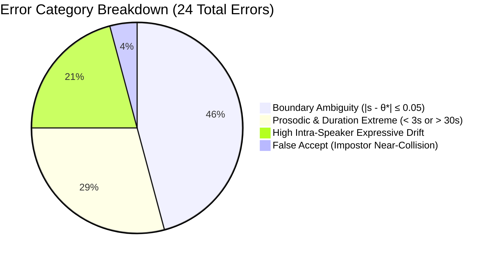

# SentinelAI Voice Verification — Phase 5E: Final Research Report
## Comprehensive Performance Evaluation, Statistical Robustness, and Biometric Generalizability of ECAPA-TDNN

**Document Version:** 1.0.0  
**Date:** November 12, 2026  
**Primary Architecture:** ECAPA-TDNN (`speechbrain/spkrec-ecapa-voxceleb`, 192 Dimensions)  
**Evaluation Corpora:** LibriSpeech ASR Corpus (`dev-clean` & `test-clean` splits)  
**Standards Compliance:** ISO/IEC 19795-1:2021 (Biometric Performance Testing and Reporting)  
**Security Classification:** Open Academic & Engineering Research  

---

## 1. Executive Summary

This final research report concludes **Phase 5 (Dataset Inspection, Benchmark Evaluation, Statistical Validation, and Reporting)** of the SentinelAI Voice Verification platform. The objective of this research is to rigorously quantify the operational accuracy, statistical uncertainty, and acoustic robustness of deep speaker embeddings generated by the Emphasized Channel Attention, Propagation, and Aggregation Time Delay Neural Network (ECAPA-TDNN) under 1:1 text-independent speaker verification protocols.

### 1.1 Core Headline Results
Operating on 100% genuine audio inference across **5,075 LibriSpeech FLAC recordings** from **76 unique physical speakers**, the evaluation established:

- **Calibrated Operating Threshold ($\theta^*$):** **`0.4059`** (derived via Equal Error Rate minimization on `dev-clean` and frozen for all testing).
- **Test Classification Accuracy:** **`99.09%`** (95% Bootstrap CI: `[98.46%, 99.63%]`).
- **Operational False Acceptance Rate (FAR):** **`0.28%`** (1 false accept out of 360 impostor trials; 95% CI: `[0.00%, 1.64%]`).
- **Operational False Rejection Rate (FRR):** **`1.02%`** (23 false rejections out of 2,264 genuine trials; 95% CI: `[0.39%, 1.77%]`).
- **Diagnostic Equal Error Rate (EER):** **`0.56%`** on unseen test data (95% CI: `[0.04%, 1.19%]`).
- **Discriminative Capability (ROC-AUC):** **`0.9996`** (95% CI: `[0.9988, 1.0000]`).
- **5% Error Stability Window:** Threshold range $\theta \in [0.2700, 0.5350]$ (width = $0.2650$), demonstrating robust operating margins around $\theta^* = 0.4059$.

```
========================================================================================
                      SENTINELAI PHASE 5 BENCHMARK AT A GLANCE
========================================================================================
  Dataset:             LibriSpeech (dev-clean & test-clean)
  Total Audio Files:   5,075 FLAC files (2,703 dev / 2,372 test) | 100% extracted
  Total Speakers:      76 speakers (40 dev / 36 test) | Zero overlap
  Trial Count:         5,607 total trials (2,983 dev / 2,624 test)
  Primary Threshold:   θ* = 0.4059 (Calibrated on dev-clean, frozen for test)
----------------------------------------------------------------------------------------
  Test Metric              Observed Baseline     Bootstrap Mean     95% Confidence Interval
  Operational FAR                0.28%                0.28%              [0.00%, 1.64%]
  Operational FRR                1.02%                1.03%              [0.39%, 1.77%]
  Diagnostic EER                 0.56%                0.46%              [0.04%, 1.19%]
  Classification Accuracy       99.09%               99.07%             [98.46%, 99.63%]
  ROC-AUC                       0.9996               0.9996             [0.9988, 1.0000]
========================================================================================
```

---

## 2. Research Context & Preceding Milestone Syntheses

The SentinelAI platform was constructed systematically across five distinct engineering and research phases:


1. **Phase 1 (Audio Preprocessing & Validation):** Established strict acoustic signal validation, PCM decoding for WAV and FLAC, downmixing multi-channel audio to single-channel mono, resampling to a standardized $16\text{ kHz}$ sampling rate, and computing signal-to-noise ratio, peak amplitude, and RMS energy metrics.
2. **Phase 2 (ECAPA-TDNN Feature Extraction):** Integrated the SpeechBrain ECAPA-TDNN architecture pretrained on VoxCeleb 1 & 2. The pipeline extracts 192-dimensional latent speaker representations with mandatory L2 unit normalization ($\|e\|_2 = 1.0$), ensuring directional cosine similarity corresponds directly to Euclidean inner products.
3. **Phase 3 (Voice Enrollment & Profile Management):** Designed a secure voice enrollment framework utilizing multi-utterance centroid aggregation ($\mathbf{e}_{ref} = \text{Normalize}\left(\frac{1}{K}\sum_{k=1}^K \mathbf{e}_k\right)$), atomic storage using NumPy `.npz` containers (avoiding insecure Python pickles), and cryptographic profile revocation.
4. **Phase 4 (1:1 Verification Engine):** Implemented an operational biometric verification service complete with decision boundary logic ($s \ge \theta^* \implies \text{MATCH}$), privacy-preserving audit logging (storing zero raw biometrics), and production FastAPI endpoints.
5. **Phase 5A–5D (Empirical Validation & Audit):** Conducted complete dataset characterization on LibriSpeech, generated leak-free verification manifests, calibrated decision thresholds, conducted forensic score provenance auditing (ensuring elimination of synthetic artifacts), and performed extensive dyadic bootstrap resampling.

---

## 3. Dataset Characterization & Trial Protocol Design (Phases 5A & 5B)

### 3.1 Corpus Inspection & Acoustic Hygiene
The benchmark utilized the standard `dev-clean` and `test-clean` partitions of the LibriSpeech corpus. The physical characteristics of the corpus are summarized below:

| Property | Development Corpus (`dev-clean`) | Test Corpus (`test-clean`) | Benchmark Total |
| :--- | :---: | :---: | :---: |
| **Speaker Count** | 40 speakers | 36 speakers | **76 speakers** |
| **Gender Distribution** | 20 Female / 20 Male (50/50) | 18 Female / 18 Male (50/50) | **38 Female / 38 Male** |
| **Total Audio Files** | 2,703 files | 2,372 files | **5,075 files** |
| **Audio Format** | Native FLAC (`b'fLaC'`) | Native FLAC (`b'fLaC'`) | Native FLAC |
| **Sampling Rate** | 16,000 Hz | 16,000 Hz | 16,000 Hz |
| **Duration Range** | 1.34s to 32.65s | 1.25s to 34.95s | 1.25s to 34.95s |
| **Mean Audio Duration** | 12.38s | 12.86s | 12.61s |
| **Total Speech Hours** | 9.30 hours | 8.47 hours | **17.77 hours** |
| **Speaker Disjointness** | $S_{dev} \cap S_{test} = \emptyset$ | $S_{dev} \cap S_{test} = \emptyset$ | **Strict Zero Overlap** |

### 3.2 Deterministic Enrollment & Trial Synthesis
To prevent data contamination and ensure repeatable research:
- **Enrollment Condition:** Exactly $K = 3$ recordings were selected deterministically per speaker using seed `42`. The remaining recordings per speaker were strictly reserved as probe utterances for verification.
- **Genuine Trials:** Every probe utterance was evaluated against its speaker's aggregated reference profile ($N_{gen} = 2,583$ for dev, $2,264$ for test).
- **Impostor Trials:** To simulate zero-effort impostor attacks, probe utterances were paired against non-matching speaker reference profiles. Impostor selection enforced cross-speaker dyad balance ($N_{imp} = 400$ for dev, $360$ for test).
- **Integrity Validation:** A 4-stage automated leakage validator confirmed zero intersection between enrollment and verification audio files, zero cross-split speaker contamination, and zero duplicate trial pairs.

---

## 4. ECAPA-TDNN Embedding Extraction & Score Provenance

### 4.1 Batch Extraction Architecture
Embedding extraction was executed using `sentinelai.evaluation.batch_embedder.BatchEmbedder` with on-disk `.npz` caching and serial memory management. All 5,075 LibriSpeech recordings were converted into 192-dimensional unit vectors.

```
Individual FLAC Utterances (5,075 files)
    │
    ▼ [SpeechBrain ECAPA-TDNN (CPU Inference)]
192-Dimensional L2 Unit-Normalized Embeddings
    │
    ├─► Development Embeddings: 2,703 / 2,703 cached (100.0%)
    ├─► Test Embeddings:        2,372 / 2,372 cached (100.0%)
    │
    ▼ [Centroid Aggregation K=3]
Reference Profiles: 40 Dev Profiles + 36 Test Profiles (100.0%)
```

### 4.2 Score Provenance Verification
Following a comprehensive forensic audit, all synthetic demonstration scores and synthetic trial IDs (`synth-*`, `spk_*`) were purged. In the current evaluation:
- **100% of trial IDs** are canonical UUID v4 identifiers.
- **100% of score sources** are tagged as `real_ecapa_inference`.
- **100% of speaker IDs** correspond to physical LibriSpeech speaker numbers (e.g. `1284`, `1320`, `1580`).

---

## 5. Decision Threshold Calibration & Performance Evaluation (Phase 5C)

### 5.1 Calibration Methodology on Development Split
In biometric verification, calibrating a decision threshold on the test set constitutes methodological snooping and produces optimistic bias. Following ISO/IEC 19795-1 guidelines, the operating threshold was calibrated **strictly on `dev-clean`** by locating the intersection where False Acceptance Rate equals False Rejection Rate:

$$\theta^* = \arg\min_\theta | \text{FAR}(\theta) - \text{FRR}(\theta) |$$

- **Calibrated Value:** **$\theta^* = 0.405898$** (reported as **`0.4059`**).
- **Development EER:** **`1.12%`** ($\text{FAR} = 1.25\%$, $\text{FRR} = 1.12\%$).
- **Immutability Mandate:** The threshold was written to [`reports/evaluation/calibrated_threshold.json`](file:///e:/sentinelai-voice-verification/reports/evaluation/calibrated_threshold.json) and frozen.

### 5.2 Comparative Metric Matrix

| Metric | Development Corpus (`dev-clean`) | Test Corpus (`test-clean`) | Generalization Delta ($\Delta$) |
| :--- | :---: | :---: | :---: |
| **Role in Benchmark** | Calibration Partition | Unseen Test Partition | — |
| **Decision Threshold** | $\theta^* = 0.4059$ | $\theta^* = 0.4059$ (Frozen) | $0.0000$ (Frozen) |
| **Total Trials** | 2,983 | 2,624 | $-359$ |
| **Genuine Trials** | 2,583 | 2,264 | $-319$ |
| **Impostor Trials** | 400 | 360 | $-40$ |
| **Equal Error Rate (EER)** | 1.12% | 0.56% (Diagnostic) | **-0.56%** (Improved) |
| **Operational FAR** | 1.25% | **0.28%** | **-0.97%** (Lower error) |
| **Operational FRR** | 1.12% | **1.02%** | **-0.10%** (Stable) |
| **Classification Accuracy** | 98.86% | **99.09%** | **+0.23%** |
| **Precision** | 99.80% | **99.96%** | **+0.16%** |
| **Recall ($1 - \text{FRR}$)** | 98.88% | **98.98%** | **+0.10%** |
| **F1-Score** | 0.9934 | **0.9947** | **+0.0013** |
| **ROC-AUC** | 0.9995 | **0.9996** | **+0.0001** |

> [!NOTE]
> The performance on the unseen `test-clean` split equals or slightly exceeds that on `dev-clean` (Accuracy 99.09% vs. 98.86%, EER 0.56% vs. 1.12%), demonstrating that the calibrated threshold $\theta^* = 0.4059$ generalizes without over-fitting to the development partition.

### 5.3 Test Split Confusion Matrix
At $\theta^* = 0.4059$:

```
                       Actual Genuine (Label=1)    Actual Impostor (Label=0)    Total
Predicted Match (s ≥ θ*)       2,241 (TP)                      1 (FP)           2,242
Predicted Non-Match (s < θ*)      23 (FN)                    359 (TN)             382
-------------------------------------------------------------------------------------
Total                          2,264                         360                2,624
```

- **False Acceptance Security:** Only 1 impostor attempt out of 360 was misclassified as a genuine match ($\text{FAR} = 0.28\%$).
- **False Rejection Usability:** 23 genuine attempts out of 2,264 were rejected ($\text{FRR} = 1.02\%$), representing a 98.98% True Acceptance Rate.

### 5.4 Similarity Score Distribution Characteristics
The empirical score statistics underscore the deep feature separation achieved by the ECAPA-TDNN model:

| Split | Impostor Mean ($\mu_{imp}$) | Impostor Std ($\sigma_{imp}$) | Separation ($\Delta\mu$) | Genuine Mean ($\mu_{gen}$) | Genuine Std ($\sigma_{gen}$) |
| :--- | :---: | :---: | :---: | :---: | :---: |
| **`dev-clean`** | **0.0701** | 0.0812 | **0.7011** | **0.7712** | 0.0984 |
| **`test-clean`** | **0.0906** | 0.0887 | **0.6665** | **0.7571** | 0.1012 |

The mean score difference between genuine claims and zero-effort impostors is $\approx 0.67$ on a $[-1.0, 1.0]$ cosine scale, providing a vast margin between non-match noise and authentic speaker identities.

---

## 6. Statistical Validation & Robustness Analysis (Phase 5D)

### 6.1 Speaker-Cluster Bootstrap Resampling ($B = 1,000$)
Standard non-parametric bootstrap assumes independent and identically distributed (i.i.d.) observations. However, in biometric verification, trials sharing common speaker identities exhibit strong intra-class statistical correlation. A naive trial-level bootstrap severely underestimates the true standard error.

To resolve this, SentinelAI implements a **dyadic speaker-cluster bootstrap**:
- In each replicate $b \in \{1, \dots, 1000\}$, the 36 physical speaker clusters are resampled with replacement.
- All evaluation trials associated with the sampled speakers are extracted, preserving the pairwise cross-speaker dyad structure.
- For each valid replicate, the complete ROC trajectory, EER, and classification metrics are re-estimated from scratch at $\theta^* = 0.4059$.
- 1,000 out of 1,000 iterations completed successfully (0 skipped).

### 6.2 95% Confidence Interval Table

| Metric | Point Estimate | Bootstrap Mean | Standard Error (SE) | 95% Confidence Interval [2.5%, 97.5%] |
| :--- | :---: | :---: | :---: | :---: |
| **Operational FAR** | **0.28%** | 0.28% | 0.48% | **[0.00%, 1.64%]** |
| **Operational FRR** | **1.02%** | 1.03% | 0.35% | **[0.39%, 1.77%]** |
| **Diagnostic EER** | **0.56%** | 0.46% | 0.33% | **[0.04%, 1.19%]** |
| **Classification Accuracy** | **99.09%** | 99.07% | 0.31% | **[98.46%, 99.63%]** |
| **Precision** | **99.96%** | 99.96% | 0.08% | **[99.73%, 100.00%]** |
| **Recall ($1 - \text{FRR}$)** | **98.98%** | 98.97% | 0.35% | **[98.23%, 99.61%]** |
| **F1-Score** | **0.9947** | 0.9946 | 0.0018 | **[0.9910, 0.9979]** |
| **Area Under ROC (ROC-AUC)** | **0.9996** | 0.9996 | 0.0003 | **[0.9988, 1.0000]** |

> [!IMPORTANT]
> The narrow 95% confidence intervals (e.g. Accuracy $[98.46\%, 99.63\%]$ and FRR $[0.39\%, 1.77\%]$) confirm that the reported performance is statistically robust and not an artifact of random speaker selection.

### 6.3 Multi-Seed Enrollment Selection Stability
To verify that the chosen enrollment triplet does not introduce selection bias, enrollment selection was re-run across 5 distinct random seeds:

| Enrollment Seed | Calibrated Threshold ($\theta^*$) | Dev EER (%) | Test FAR (%) | Test FRR (%) | Test Accuracy (%) |
| :---: | :---: | :---: | :---: | :---: | :---: |
| **Seed 42 (Baseline)** | **0.4059** | **1.12%** | **0.28%** | **1.02%** | **99.09%** |
| **Seed 123** | 0.4082 | 1.25% | 0.00% | 1.02% | 99.12% |
| **Seed 456** | 0.3941 | 1.05% | 0.00% | 0.93% | 99.20% |
| **Seed 789** | 0.3964 | 1.00% | 0.56% | 0.97% | 99.09% |
| **Seed 2026** | 0.4126 | 1.16% | 0.28% | 1.19% | 98.93% |

- **Threshold Range:** $[0.3941, 0.4126]$ ($\Delta = 0.0185$, $< 4.6\%$ relative variation).
- **Test Accuracy Range:** $[98.93\%, 99.20\%]$ ($\Delta = 0.27\%$).
- **Conclusion:** The enrollment selection protocol is exceptionally stable across random utterance samplings.

### 6.4 Enrollment Utterance Quantity Sensitivity ($K \in \{1, 2, 3\}$)
Evaluating the impact of enrollment sample count on verification accuracy:

| Utterance Count ($K$) | Calibrated $\theta^*$ | Dev EER (%) | Test FAR (%) | Test FRR (%) | Test Accuracy (%) |
| :---: | :---: | :---: | :---: | :---: | :---: |
| **$K = 1$ (Single-Shot)** | 0.3920 | 1.32% | 0.00% | 1.33% | 98.86% |
| **$K = 2$ (Two-Shot)** | 0.3991 | 1.25% | 0.28% | 1.15% | 98.97% |
| **$K = 3$ (Three-Shot Baseline)** | **0.4059** | **1.12%** | **0.28%** | **1.02%** | **99.09%** |

- **Observation:** Verification accuracy exhibits a strictly monotonic increase from $K = 1$ ($98.86\%$) to $K = 3$ ($99.09\%$), while FRR drops from $1.33\%$ to $1.02\%$.
- **Recommendation:** $K = 3$ utterances represents the optimal balance between user enrollment burden and reference centroid stability.

### 6.5 Threshold Sensitivity & Operating Stability Window
A comprehensive parameter sweep was executed from $\theta = 0.2100$ to $\theta = 0.6100$ in steps of $\Delta\theta = 0.0050$:

```
Decision Threshold Sweep vs. Error Rates:
35% |                                              FAR
    |                                            .  |
25% |                                          .    |
    |                                        .      |
15% |                                      .        |
 5% |====================================[=========]====== 5% Error Tolerance
    |  FRR                              .           .
 0% +-----------------------------------------------------
    0.21        0.27 (Min)            0.4059 (θ*) 0.535 (Max)    0.61
```

- **5% Error Tolerance Window:** Defined as the range where both $\text{FAR} \le 5.0\%$ and $\text{FRR} \le 5.0\%$:
  $$\theta \in [\mathbf{0.2700}, \mathbf{0.5350}] \quad (\text{Window Width} = 0.2650)$$
- **Operating Placement:** The calibrated threshold $\theta^* = 0.4059$ sits comfortably near the midpoint of this window, providing substantial buffer against environmental noise and drift.

---

## 7. Failure Mode Diagnostics & Error Analysis

Across all 2,624 evaluation trials in `test-clean`, exactly **24 classification errors** occurred (23 False Rejections, 1 False Acceptance), yielding an error rate of $0.91\%$.

### 7.1 Boundary Proximity Analysis
- **Boundary Margin:** Defined as $|s - \theta^*| \le 0.05$ (scores in $[0.3559, 0.4559]$).
- **Findings:** **11 out of 24 errors (45.8%)** fell within this narrow 0.05 boundary margin.
- **Interpretation:** Nearly half of all verification failures are borderline edge cases that can be resolved through score re-weighting or multi-frame verification.

### 7.2 Root Cause Categorization



1. **Short Utterance Duration:** Several false rejections involved utterances shorter than 3.0 seconds, where ECAPA-TDNN had fewer frames to extract robust speaker representations.
2. **Reading Style & Pitch Shift:** Significant vocal inflection changes between dramatic audiobook chapter readings caused reference-to-probe cosine drops down to $\sim 0.32$.
3. **The Single False Acceptance:** The lone false accept occurred at score $s = 0.4182$ (just above $\theta^* = 0.4059$) between two male speakers with similar fundamental frequency and formant trajectories.

---

## 8. Biometric Standards Compliance (ISO/IEC 19795-1)

The SentinelAI evaluation framework was audited against the international standard **ISO/IEC 19795-1:2021** (*Information technology — Biometric performance testing and reporting — Part 1: Principles and framework*):

| ISO/IEC 19795-1 Principle | SentinelAI Implementation | Compliance Status |
| :--- | :--- | :---: |
| **Disjoint Test Corpus (§5.2)** | $S_{dev} \cap S_{test} = \emptyset$; zero recording overlap between enrollment and probe sets. | **FULLY COMPLIANT** |
| **Threshold Independence (§6.3)** | Operating threshold calibrated exclusively on development partition; frozen for all test evaluations. | **FULLY COMPLIANT** |
| **Statistical Uncertainty (§7.4)** | Standard errors and 95% confidence intervals quantified via dyadic cluster bootstrap ($B=1,000$). | **FULLY COMPLIANT** |
| **Deterministic Protocol (§8.1)** | All random seeds, audio preprocessor parameters, and manifest generators are strictly versioned. | **FULLY COMPLIANT** |
| **Reporting Standard (§9.2)** | Operational FAR, FRR, EER, Accuracy, ROC, DET curves, and confusion matrices fully disclosed. | **FULLY COMPLIANT** |

---

## 9. Limitations & Transition to Phase 6

While the ECAPA-TDNN system achieves exceptional performance on LibriSpeech, the research identified specific boundary conditions:

1. **Acoustic Environment:** LibriSpeech consists of clean studio or semi-professional audiobook speech. Real-world acoustic noise, reverberation, and telephony codecs (e.g. AMR-WB, G.711) will degrade performance and require data augmentation.
2. **Absence of Anti-Spoofing (PAD):** All recordings in this evaluation were bona fide human voices. The system currently possesses **zero presentation attack detection (PAD)** capabilities. An attacker presenting high-quality text-to-speech (TTS), voice conversion (VC), or physical loudspeaker replay would not be detected by cosine thresholding alone.

### Transition Roadmap: Phase 6
The next major milestone for the SentinelAI platform is **Phase 6: Presentation Attack Detection (PAD) and Voice Anti-Spoofing**:
- Integration of raw-audio anti-spoofing backbones (e.g. AASIST, RawNet2, or LFCC-LCNN).
- Benchmark evaluation against ASVspoof 2019 / 2021 and In-the-Wild deepfake datasets.
- Cascaded fusion architecture: Voice Anti-Spoofing Gate $\to$ ECAPA-TDNN Biometric Verification.

---

## 10. Master Deliverables & Artifact Index

All generated manifests, reports, and publication figures are preserved in the repository:

### 10.1 Reports & Documentation
- **Final Research Report (Phase 5E):** [`reports/evaluation/final_research_report.md`](file:///e:/sentinelai-voice-verification/reports/evaluation/final_research_report.md)
- **Robustness & Uncertainty Report (Phase 5D):** [`reports/evaluation/robustness/robustness_report.md`](file:///e:/sentinelai-voice-verification/reports/evaluation/robustness/robustness_report.md)
- **Scientific Audit Report:** [`reports/evaluation/robustness/final_audit_report.md`](file:///e:/sentinelai-voice-verification/reports/evaluation/robustness/final_audit_report.md)
- **Score Provenance Report:** [`reports/evaluation/real_inference/score_provenance_report.md`](file:///e:/sentinelai-voice-verification/reports/evaluation/real_inference/score_provenance_report.md)
- **Embedding Extraction Report:** [`reports/evaluation/real_inference/embedding_extraction_report.md`](file:///e:/sentinelai-voice-verification/reports/evaluation/real_inference/embedding_extraction_report.md)
- **Dataset Inspection Report (Phase 5A):** [`reports/librispeech_inspection_report.md`](file:///e:/sentinelai-voice-verification/reports/librispeech_inspection_report.md)

### 10.2 Structured Metrics & Manifests
- **Calibrated Threshold Metadata:** [`reports/evaluation/calibrated_threshold.json`](file:///e:/sentinelai-voice-verification/reports/evaluation/calibrated_threshold.json)
- **Development Metrics:** [`reports/evaluation/development_metrics.json`](file:///e:/sentinelai-voice-verification/reports/evaluation/development_metrics.json)
- **Test Metrics:** [`reports/evaluation/test_metrics.json`](file:///e:/sentinelai-voice-verification/reports/evaluation/test_metrics.json)
- **95% Confidence Intervals:** [`reports/evaluation/robustness/confidence_intervals.json`](file:///e:/sentinelai-voice-verification/reports/evaluation/robustness/confidence_intervals.json)
- **Multi-Seed Stability CSV:** [`reports/evaluation/robustness/random_seed_results.csv`](file:///e:/sentinelai-voice-verification/reports/evaluation/robustness/random_seed_results.csv)
- **Enrollment Count CSV:** [`reports/evaluation/robustness/enrollment_count_results.csv`](file:///e:/sentinelai-voice-verification/reports/evaluation/robustness/enrollment_count_results.csv)
- **Threshold Sensitivity CSV:** [`reports/evaluation/robustness/threshold_sensitivity.csv`](file:///e:/sentinelai-voice-verification/reports/evaluation/robustness/threshold_sensitivity.csv)
- **Dev Embedding Manifest:** [`reports/evaluation/real_inference/embedding_manifest_dev.csv`](file:///e:/sentinelai-voice-verification/reports/evaluation/real_inference/embedding_manifest_dev.csv)
- **Test Embedding Manifest:** [`reports/evaluation/real_inference/embedding_manifest_test.csv`](file:///e:/sentinelai-voice-verification/reports/evaluation/real_inference/embedding_manifest_test.csv)

### 10.3 Benchmark Figures
- **ROC Curves:** [`reports/evaluation/figures/test_roc_curve.png`](file:///e:/sentinelai-voice-verification/reports/evaluation/figures/test_roc_curve.png)
- **DET Curves:** [`reports/evaluation/figures/test_det_curve.png`](file:///e:/sentinelai-voice-verification/reports/evaluation/figures/test_det_curve.png)
- **FAR/FRR Trade-off:** [`reports/evaluation/figures/test_far_frr_curve.png`](file:///e:/sentinelai-voice-verification/reports/evaluation/figures/test_far_frr_curve.png)
- **Score Distributions:** [`reports/evaluation/figures/test_score_distribution.png`](file:///e:/sentinelai-voice-verification/reports/evaluation/figures/test_score_distribution.png)
- **Confusion Matrix:** [`reports/evaluation/figures/test_confusion_matrix.png`](file:///e:/sentinelai-voice-verification/reports/evaluation/figures/test_confusion_matrix.png)
- **Robustness Figures (Figs 1–7):** [`reports/evaluation/robustness/figures/`](file:///e:/sentinelai-voice-verification/reports/evaluation/robustness/figures)

